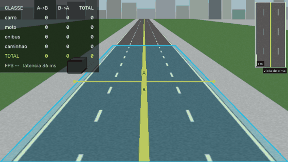
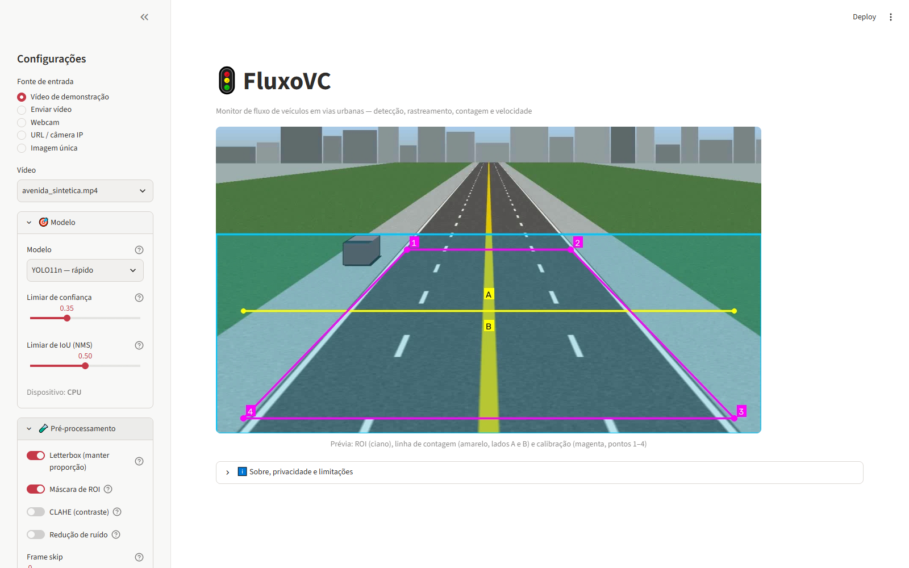
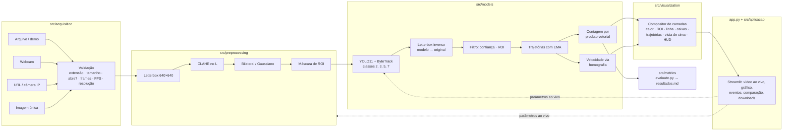
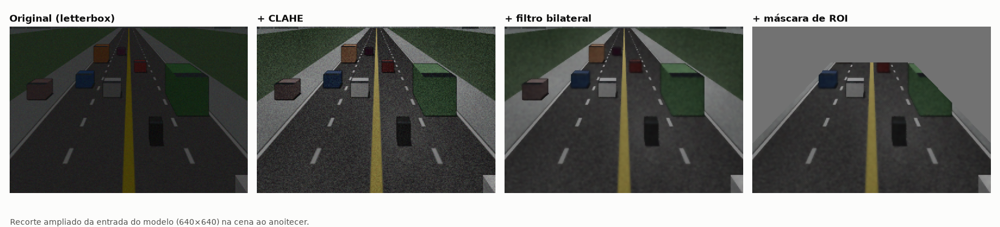
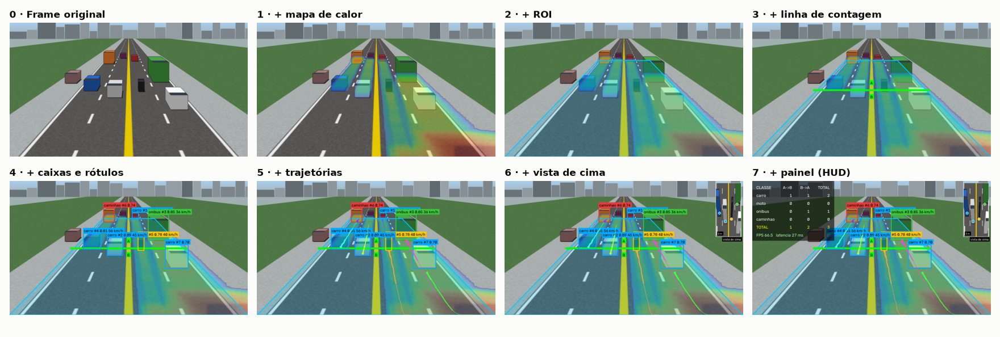
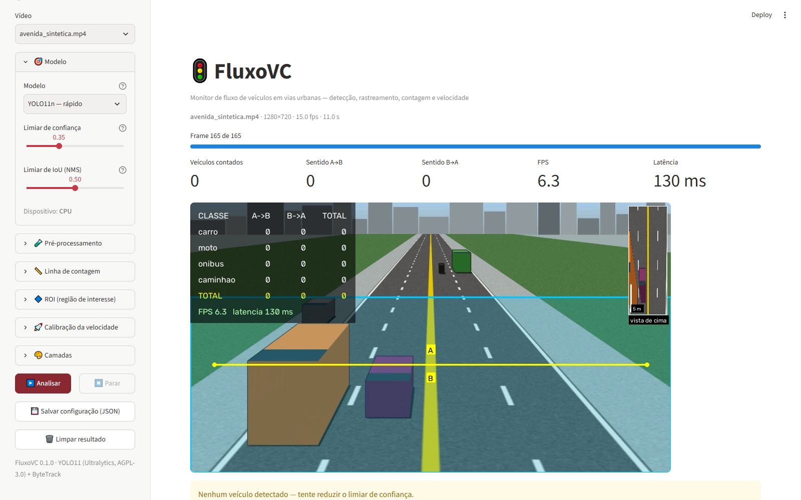

# 🚦 FluxoVC — Monitor de fluxo de veículos em vias urbanas

Trabalho final da disciplina de **Computação Gráfica** (`<Disciplina / turma / semestre>`).
O FluxoVC é uma aplicação interativa de visão computacional em Python que **detecta, rastreia e
conta veículos** em vídeo, desenha trajetórias e um mapa de calor de ocupação e **estima a
velocidade** com uma transformação de perspectiva, sem sensores físicos na via.



*Demonstração gerada com o código do FluxoVC sobre uma cena sintética com detecções simuladas.
Veja como ela é gerada em [docs/computacao_grafica.md](docs/computacao_grafica.md).*
`<Equipe: acrescentar aqui um GIF ou print com o vídeo real de data_samples/.>`

## Sumário

[Problema](#problema) · [Requisitos](#requisitos) · [Instalação](#instalação) ·
[Execução](#execução) · [Arquitetura](#arquitetura) · [Pré-processamento](#pré-processamento) ·
[Método visual](#método-visual) · [Parâmetros](#parâmetros-da-interface) ·
[Métricas](#métricas-e-resultados) · [Acertos e erros](#exemplos-de-acertos-e-erros) ·
[Limitações](#limitações-conhecidas) · [Ética](#ética-e-privacidade) ·
[Créditos](#fontes-créditos-e-licenças) · [Uso de IA](#declaração-de-uso-de-ia) ·
[Equipe](#contribuição-dos-integrantes)

## Problema

Prefeituras, órgãos de trânsito e pesquisadores de mobilidade precisam saber **quantos veículos
passam, de que tipo, em que sentido e a que velocidade**. Contadores pneumáticos, laços indutivos
e radares exigem instalação e manutenção na via. O FluxoVC usa só um vídeo, de arquivo, webcam ou
câmera IP, e:

- detecta **carros, motos, ônibus e caminhões** (YOLO11, classes do COCO) e mantém um **ID** para
  cada veículo (ByteTrack);
- **conta** quantos cruzam uma linha virtual, por classe e por sentido (A→B e B→A);
- desenha **trajetórias suavizadas** e um **mapa de calor** da ocupação da pista;
- estima a **velocidade** (km/h) com uma **homografia** calibrada pelo usuário e mostra a **vista
  de cima** da pista;
- exporta os eventos (CSV) e o vídeo anotado (MP4).

**Público:** gestores de trânsito, estudantes e pesquisadores de mobilidade urbana.

**Por que não é só rodar um modelo pronto:** o YOLO só entrega caixas. Foram implementados pela
equipe:
- a conversão entre espaços de coordenadas (letterbox e seu inverso);
- a ROI;
- a contagem por cruzamento de linha;
- a homografia para velocidade e a vista de cima;
- a suavização das trajetórias;
- o mapa de calor;
- a composição por camadas;
- as métricas contra a contagem manual;
- a interface com parâmetros ao vivo.

## Requisitos

- **Python 3.10+**, testado com **Python 3.12.10** no **Windows 10**.
- Roda em **CPU**. Se houver GPU NVIDIA com PyTorch CUDA instalado, ela é usada automaticamente.
- Internet **só na primeira análise**, para baixar os pesos do YOLO (cerca de 5,6 MB o `yolo11n.pt`
  e 19 MB o `yolo11s.pt`). Os pesos ficam em `pesos/`, fora do git.

| Biblioteca | Versão | Uso |
|---|---|---|
| opencv-python | 5.1.0.95 | leitura de vídeo, pré-processamento, desenho, homografia |
| numpy | 2.5.5 | operações vetoriais |
| pillow | 13.0.0 | imagens na interface e GIF |
| ultralytics | 8.4.216 | YOLO11 + ByteTrack |
| lap | 0.5.14 | associação do ByteTrack |
| torch / torchvision | 2.15.0 / 0.29.2 | backend do YOLO |
| streamlit | 1.67.0 | interface |
| pandas / matplotlib | 3.1.1 / 3.11.2 | tabelas, métricas e gráficos |
| psutil | 7.2.2 | memória (métricas de desempenho) |
| python-dotenv | 1.2.4 | `.env` (VLM opcional) |
| pytest | 9.2.0 | testes |

As versões fixadas estão em [requirements.txt](requirements.txt).

## Instalação

```bash
python -m venv .venv
# Windows
.venv\Scripts\activate
# Linux/macOS
source .venv/bin/activate

pip install -r requirements.txt
```

## Execução

```bash
streamlit run app.py
```

O navegador abre em <http://localhost:8501>. Na barra lateral:

1. Escolha a **fonte**: vídeo de demonstração, envio de vídeo, webcam, URL ou imagem única.
2. Confira na **prévia** a ROI (ciano), a linha de contagem (amarelo, lados A e B) e os pontos de
   calibração (magenta). Ajuste nos painéis da barra lateral.
3. Clique em **▶️ Analisar**. Ao final, baixe os eventos, o resumo e o vídeo processado.



### Outros comandos

```bash
pytest                                   # 300 testes, nenhum depende de baixar pesos (cerca de 40 s)
python scripts/evaluate.py               # avaliação em lote → docs/resultados.md
python scripts/extrair_frames.py <vídeo> # frames para anotar (CVAT / Label Studio)
python scripts/gerar_figuras.py          # figuras de docs/computacao_grafica.md
```

## Arquitetura



O `app.py` contém só a interface. A lógica fica em `src/`, testável sem Streamlit e sem pesos: os
testes injetam um detector falso que cumpre o mesmo contrato do YOLO.

### Estrutura de pastas

```
FluxoVC/
├── app.py                      # interface Streamlit (só UI)
├── src/
│   ├── acquisition/            # fontes (arquivo, webcam, URL, imagem) e validação
│   ├── preprocessing/          # letterbox, ROI, CLAHE, redução de ruído, frame skip
│   ├── geometry/               # espaços de coordenadas, ROI, homografia, EMA
│   ├── models/                 # wrapper YOLO + ByteTrack, interpretação, trajetórias, contagem
│   ├── visualization/          # camadas, mapa de calor, vista de cima, compositor, gravador MP4
│   ├── metrics/                # qualidade (P/R/F1, erro de contagem, MAE), desempenho, relatório
│   ├── aplicacao/              # sessão de análise frame a frame e tabelas para a interface
│   ├── config.py               # todos os parâmetros (dataclasses) + salvar/carregar JSON
│   └── logs.py                 # logging
├── data_samples/               # vídeos curtos + LICENSES.md
│   └── ground_truth/           # configuração, contagem manual e frames anotados
├── docs/                       # pipeline, computação gráfica, métricas, resultados, figuras
├── scripts/                    # evaluate.py, extrair_frames.py, gerar_figuras.py, cena_sintetica.py
├── tests/                      # pytest (vídeos sintéticos + detectores falsos)
├── outputs/                    # vídeos processados (ignorado pelo git)
├── pesos/                      # pesos do YOLO baixados (ignorado pelo git)
└── requirements.txt
```

### Documentação

| Documento | Conteúdo |
|---|---|
| [docs/pipeline.md](docs/pipeline.md) | cada etapa da pipeline, decisões e parâmetros |
| [docs/computacao_grafica.md](docs/computacao_grafica.md) | os 10 requisitos de CG, com código e figuras |
| [docs/metricas.md](docs/metricas.md) | definição das métricas, como fazer a contagem manual e anotar os frames |
| [docs/resultados.md](docs/resultados.md) | tabelas e gráficos gerados pelo `evaluate.py` |

## Pré-processamento

Cada operação tem um toggle e uma explicação (ícone ❓) na interface, e todas são aplicadas
**nesta ordem**:

| Operação | O que faz | Por quê | Parâmetros |
|---|---|---|---|
| **Letterbox** | redimensiona para 640 × 640 com a mesma escala nos dois eixos e completa com faixas cinza | o YOLO espera um quadrado; esticar achataria os veículos | liga/desliga (desligado estica, só para comparação) |
| **CLAHE** | equalização adaptativa de contraste só no canal L (LAB) | recupera detalhes em cenas escuras ou em contraluz sem mudar as cores | limite de contraste, tamanho da grade |
| **Redução de ruído** | filtro bilateral (preserva bordas) ou gaussiano (mais rápido) | ruído de sensor e compressão gera detecções instáveis | tipo e tamanho do kernel |
| **Máscara de ROI** | pinta de cinza o que está fora do polígono | o modelo não gasta detecções com calçadas e estacionamentos | pontos do polígono |
| **Frame skip** | processa 1 frame e pula *n* | ganho de FPS em CPU | *n* (0 a 5) |

O letterbox vem primeiro para que o custo das demais operações seja o mesmo em qualquer resolução.
Detalhes em [docs/pipeline.md](docs/pipeline.md#2-pré-processamento--srcpreprocessing).



## Método visual

Todo o desenho é feito com OpenCV, em camadas que podem ser ligadas e desligadas durante a
análise:



| Camada | Técnica |
|---|---|
| Mapa de calor | grade de ocupação (terço inferior das caixas), raiz quadrada, `GaussianBlur`, colormap TURBO/JET, `addWeighted` com máscara |
| ROI | `fillPoly` numa máscara e mistura semitransparente só dentro dela |
| Linha de contagem | lados A/B ao longo da normal; pisca em verde ao ser cruzada |
| Caixas | cor por classe e rótulo "classe #ID confiança km/h" |
| Trajetórias | pontos suavizados por EMA, cor por ID, cauda afinando |
| Vista de cima | `warpPerspective` do trecho calibrado, com os veículos e uma régua de 5 m |
| HUD | tabela classe × sentido, FPS e latência |

**Contagem:** o ponto de referência é o **centro da base da caixa**, o contato com o chão. Um
veículo é contado quando o **sinal do produto vetorial** entre esse ponto e a linha muda entre dois
frames **e** o deslocamento atravessa o **segmento** (e não o prolongamento da linha). Cada ID
conta uma vez.

**Velocidade:** 4 pontos de um trecho retangular da pista, mais as medidas reais, dão uma
homografia imagem → metros. A velocidade é a distância percorrida no plano da pista numa janela de
1 s.

Explicação completa, com código e figuras: [docs/computacao_grafica.md](docs/computacao_grafica.md).

## Parâmetros da interface

Todos ficam na barra lateral, sem editar código. Os marcados com ⚡ valem **ao vivo**, durante a
análise. Os demais valem a partir da próxima análise, para que uma contagem não misture duas
geometrias.

| Grupo | Parâmetro | Padrão |
|---|---|---|
| Fonte | demonstração · enviar vídeo (mp4/avi/mov, até 200 MB) · webcam (índice) · URL (http/rtsp) · imagem única | — |
| Modelo | YOLO11n (rápido) ou YOLO11s (mais preciso) | n |
| | ⚡ limiar de confiança | 0,35 |
| | ⚡ limiar de IoU (NMS) | 0,50 |
| Pré-processamento | ⚡ letterbox, ROI, CLAHE (limite, grade), redução de ruído (filtro, kernel), frame skip | letterbox e ROI ligados |
| Linha de contagem | pontos A e B (coordenadas normalizadas), ponto do veículo (base/centro) | horizontal em y = 0,60 |
| ROI | tabela de pontos editável (≥ 3) | faixa inferior do frame |
| Calibração | 4 pontos, largura e comprimento reais (m), α da EMA | 7 m × 20 m, α = 0,4 |
| Camadas | ⚡ cada camada, opacidade do mapa de calor e da ROI, colormap | todas, exceto o mapa de calor |
| Ações | Analisar · Parar · Salvar configuração (JSON) · Limpar | — |

## Métricas e resultados

| Tipo | Métrica | Referência |
|---|---|---|
| Qualidade | erro de contagem absoluto e percentual, por classe e sentido; **MAE** por classe | contagem manual (`ground_truth/<vídeo>_contagem.csv`) |
| Qualidade | **precisão, recall e F1** de detecção (IoU ≥ 0,5) | cerca de 30 frames anotados no formato YOLO |
| Qualidade | estabilidade do rastreamento: IDs por veículo real e trocas de ID estimadas | contagem manual |
| Desempenho | **FPS**, × tempo real, latência por etapa (média e p95), memória de pico | — |

Comparações: **YOLO11n × YOLO11s** e **com × sem frame skip**. Tudo é gerado por
`python scripts/evaluate.py` em **[docs/resultados.md](docs/resultados.md)**. O procedimento de
anotação está em [docs/metricas.md](docs/metricas.md).

Medido numa CPU AMD sem GPU, com o pipeline completo: **cerca de 9 FPS com o YOLO11n e 4 FPS com o
YOLO11s**.

`<Equipe: depois de rodar o evaluate.py com o vídeo real, resumir aqui os números principais
(MAE, F1 e FPS) e o que eles mostram.>`

## Exemplos de acertos e erros

**Acertos verificados (cena sintética, em que a resposta certa é conhecida):**
- Os 8 veículos em movimento foram contados, com a classe e o sentido corretos. O carro
  estacionado na calçada foi ignorado pela ROI (`tests/test_cena_sintetica.py`).
- A velocidade estimada pela homografia ficou a até **4 %** da velocidade real
  ([tabela](docs/computacao_grafica.md#3-transformação-de-perspectiva-homografia)).
- O letterbox inverso devolve a coordenada original com erro ≤ 1 px em 6 resoluções.

**Erros e limitações observados:**
- **Frame skip + suavização forte:** com frame skip 2 e α = 0,4, o ponto suavizado de um veículo
  ficou atrasado, o veículo saiu da ROI antes de cruzar a linha e **não foi contado**
  ([detalhes](docs/metricas.md#efeito-observado-suavização--frame-skip)).
- **Fora da distribuição do modelo:** o YOLO não reconhece veículos desenhados (cena sintética) e
  a interface mostra o aviso de "nenhum veículo detectado":



`<Equipe: acrescentar 2 prints de acerto e 2 de erro com o vídeo real (por exemplo: oclusão entre
um ônibus e um carro, moto não detectada à distância, troca de ID), com uma frase explicando cada
um.>`

## Limitações conhecidas

- **Oclusão:** veículos escondidos atrás de ônibus ou caminhões podem perder o ID e ser
  recontados, ou nem ser vistos.
- **Noite, chuva e contraluz:** reduzem o recall. O CLAHE e o filtro ajudam, mas não resolvem
  faróis ofuscando a câmera nem gotas na lente.
- **Câmera tremida ou em movimento:** a linha, a ROI e a calibração são fixas na imagem. Se a
  câmera mexer, a contagem e a velocidade erram.
- **Velocidade depende da calibração:** medidas reais erradas viram erro proporcional, e a
  homografia só vale para o plano da pista (rampas e lombadas distorcem).
- **Classes do COCO:** vans, picapes, bicicletas, carroças e veículos especiais são confundidos
  com carro ou caminhão, ou ignorados.
- **Veículos pequenos ou distantes:** com poucos pixels na imagem o detector falha, principalmente
  com o YOLO11n.
- **Desempenho em CPU:** cerca de 9 FPS. Para vídeo ao vivo a 30 fps, use frame skip ou GPU.
- **Contagem perto da borda da ROI:** se a linha estiver perto da borda, veículos podem sair da
  ROI antes de serem contados. Deixe uma margem.

## Ética e privacidade

- **Foco em veículos:** só as classes carro, moto, ônibus e caminhão são processadas. A classe
  **pessoa é descartada** já na saída do detector.
- **Sem placas e sem identificação:** nenhuma placa é lida, recortada ou salva. O sistema não faz
  OCR nem reconhecimento facial.
- **Dados locais:** a análise roda no computador do usuário. Os vídeos enviados ficam numa pasta
  temporária, e os resultados vão para `outputs/`, fora do git. Nada é enviado para a internet,
  exceto o download dos pesos na primeira vez.
- **Vídeos de teste:** só com licença livre (Pexels, Pixabay) ou gravados pela equipe em via
  pública, sem pessoas identificáveis nem placas legíveis. Origem e licença em
  [data_samples/LICENSES.md](data_samples/LICENSES.md).
- **Uso responsável:** o FluxoVC é uma ferramenta de **estatística de fluxo**. A velocidade
  estimada é aproximada e **não serve para fiscalização ou multa**.

## Fontes, créditos e licenças

| Item | Licença / origem |
|---|---|
| [Ultralytics YOLO](https://github.com/ultralytics/ultralytics) (detector e implementação do ByteTrack) | **AGPL-3.0**. Como o FluxoVC usa essa biblioteca, o código deste projeto também é distribuído publicamente (este repositório). |
| Pesos `yolo11n.pt` / `yolo11s.pt` | treinados pela Ultralytics no dataset **[COCO](https://cocodataset.org/)** (anotações CC BY 4.0), baixados de [ultralytics/assets](https://github.com/ultralytics/assets/releases) |
| ByteTrack (algoritmo) | Zhang et al., *ByteTrack: Multi-Object Tracking by Associating Every Detection Box*, ECCV 2022 |
| OpenCV | Apache-2.0 |
| NumPy, pandas, PyTorch, torchvision, psutil, python-dotenv | BSD-3-Clause |
| Pillow | MIT-CMU (HPND) |
| Streamlit | Apache-2.0 |
| matplotlib | Matplotlib License (baseada na PSF) |
| lap | BSD-2-Clause |
| pytest | MIT |
| Vídeos de amostra | ver [data_samples/LICENSES.md](data_samples/LICENSES.md) |

**Código adaptado:** nenhum trecho foi copiado de terceiros. O letterbox segue a convenção do
Ultralytics (escala única, imagem centralizada, preenchimento cinza 114), para que a entrada seja
igual à usada no treino. `<Equipe: listar aqui qualquer código adaptado de outra fonte, com o
link.>`

## Declaração de uso de IA

> **Equipe: preencher e revisar este bloco antes da entrega.**

| Campo | Resposta |
|---|---|
| **Ferramenta** | Claude Code (Anthropic) |
| **Finalidade** | `<ex.: gerar o código inicial de cada fase a partir do nosso prompt, escrever testes e documentação, sugerir correções>` |
| **Partes afetadas** | `<ex.: todos os módulos de src/, app.py, tests/, scripts/ e docs/ foram gerados com auxílio da ferramenta, fase a fase>` |
| **Como a equipe revisou e validou** | `<ex.: leitura de cada fase antes do commit; execução do pytest; testes manuais no app com o vídeo real; comparação da contagem com a contagem manual; ajustes feitos por nós: ...>` |
| **O que a equipe fez sem IA** | `<ex.: escolha e gravação dos vídeos, contagem manual, anotação dos frames, calibração das medidas reais, análise dos resultados>` |
| **Limitações percebidas** | `<ex.: erros encontrados no código gerado e como foram corrigidos>` |


## Contribuição dos integrantes

| Integrante | Responsabilidade |
|---|---|
| `<Integrante 1>` | Aquisição e validação + interface |
| `<Integrante 2>` | Pré-processamento + geometria |
| `<Integrante 3>` | Modelo, rastreamento e contagem |
| `<Integrante 4>` | Visualização + métricas + documentação |
