# Computação Gráfica no FluxoVC

Este documento mostra, para cada um dos 10 requisitos de Computação Gráfica do trabalho, **onde
está no código**, **um trecho** da implementação e **uma figura** do resultado.

> **Sobre as figuras.** Elas foram geradas por `python scripts/gerar_figuras.py`, que roda o
> código real do FluxoVC (`src/`) sobre uma **cena sintética**: uma avenida desenhada em
> perspectiva com uma homografia conhecida ([`scripts/cena_sintetica.py`](../scripts/cena_sintetica.py)).
> Só o vídeo e as detecções são simulados: um detector "falso" devolve a caixa de cada veículo
> desenhado, com ruído de ±2 px e ID fixo, como faria o YOLO + ByteTrack. Isso permite comparar o
> resultado com a verdade (por exemplo, a velocidade real de cada veículo). O desempenho do YOLO
> em vídeo real está em [`resultados.md`](resultados.md).

| # | Requisito | Onde | Figura |
|---|---|---|---|
| 1 | Mapeamento de coordenadas modelo → original → interface | `src/geometry/coordenadas.py` | [01](#1-mapeamento-de-coordenadas) |
| 2 | Redimensionamento mantendo a proporção | `src/preprocessing/operacoes.py` | [02](#2-redimensionamento-mantendo-a-proporção-letterbox) |
| 3 | Transformação de perspectiva (homografia) | `src/geometry/homografia.py` | [03](#3-transformação-de-perspectiva-homografia) |
| 4 | Composição por camadas com transparência | `src/visualization/compositor.py`, `desenho.py` | [04](#4-composição-por-camadas-com-transparência) |
| 5 | Mapa de calor com colormap | `src/visualization/mapa_calor.py` | [05](#5-mapa-de-calor-com-colormap) |
| 6 | Caixas, linhas, trajetórias, polígonos e texto | `src/visualization/camadas.py` | [06](#6-desenho-de-caixas-linhas-trajetórias-polígonos-e-texto) |
| 7 | Atualização em tempo real | `app.py`, `src/aplicacao/sessao.py` | [07](#7-atualização-em-tempo-real) |
| 8 | Suavização de coordenadas (EMA) | `src/geometry/suavizacao.py` | [08](#8-suavização-de-coordenadas-ema) |
| 9 | ROI | `src/geometry/roi.py`, `src/preprocessing/operacoes.py` | [09](#9-roi-região-de-interesse) |
| 10 | Comparação original × processada × final | `src/visualization/compositor.py` | [10](#10-comparação-original--processada--final) |

---

## 1. Mapeamento de coordenadas

Um mesmo ponto passa por **quatro espaços**:

| Espaço | Tamanho (exemplo) | Quem usa |
|---|---|---|
| normalizado (0–1) | — | interface: linha, ROI e calibração não dependem da resolução |
| **modelo** | 640 × 640 | entrada e saída do YOLO (com as faixas do letterbox) |
| **original** | 1280 × 720 | contagem, trajetórias, velocidade e mapa de calor |
| **exibição** | 960 × 540 | desenho na tela (a imagem é reduzida **antes** de desenhar) |

O YOLO devolve caixas no espaço do modelo. O **letterbox inverso** desconta as faixas e divide
pela escala. Depois, o desenho multiplica pela escala de exibição:

```python
# src/geometry/coordenadas.py
def original_para_modelo(pontos, p):
    arr = _pontos(pontos)
    return np.column_stack((arr[:, 0] * p.escala_x + p.pad_x, arr[:, 1] * p.escala_y + p.pad_y))

def modelo_para_original(pontos, p, limitar=True):
    arr = _pontos(pontos)
    saida = np.column_stack(((arr[:, 0] - p.pad_x) / p.escala_x, (arr[:, 1] - p.pad_y) / p.escala_y))
    if limitar:  # pontos que caem na faixa cinza vão para a borda do frame
        saida[:, 0] = np.clip(saida[:, 0], 0, p.largura_orig)
        saida[:, 1] = np.clip(saida[:, 1], 0, p.altura_orig)
    return saida

def original_para_exibicao(pontos, escala):
    return _pontos(pontos) * escala
```

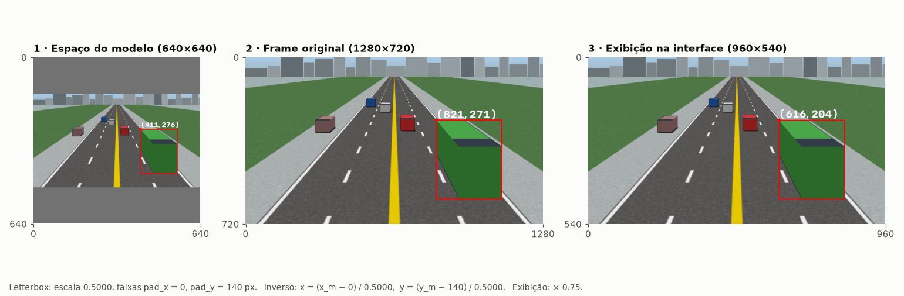

O canto da caixa do ônibus é **(411, 276)** no modelo. Com escala 0,5 e `pad_y = 140`, isso dá
((411 − 0) / 0,5; (276 − 140) / 0,5) ≈ **(821, 271)** no original e, × 0,75, **(616, 204)** na
tela.

**Testes:** a ida e volta original → modelo → original devolve o mesmo ponto com erro ≤ 1 px em 6
resoluções, inclusive vídeo em retrato. Também há um teste com imagem real: um objeto é desenhado,
passa pelo letterbox e é reencontrado na posição original (`tests/test_geometria.py`).

## 2. Redimensionamento mantendo a proporção (letterbox)

O modelo espera um quadrado. Esticar o frame 16:9 para 640 × 640 achata os veículos, e o detector
foi treinado com objetos sem distorção. O letterbox usa **a mesma escala nos dois eixos** e
preenche o resto com cinza (114, 114, 114), o mesmo valor usado no treino do YOLO:

```python
# src/geometry/coordenadas.py — calcular_letterbox()
escala = min(tamanho / largura, tamanho / altura)
nova_largura = min(tamanho, max(1, round(largura * escala)))
nova_altura = min(tamanho, max(1, round(altura * escala)))
pad_x = (tamanho - nova_largura) // 2
pad_y = (tamanho - nova_altura) // 2

# src/preprocessing/operacoes.py — aplicar_letterbox()
interpolacao = cv2.INTER_AREA if reduzindo else cv2.INTER_LINEAR  # INTER_AREA evita serrilhado
redimensionada = cv2.resize(imagem, (p.nova_largura, p.nova_altura), interpolation=interpolacao)
saida = np.full((tamanho, tamanho, 3), cor, dtype=np.uint8)
saida[p.pad_y : p.pad_y + p.nova_altura, p.pad_x : p.pad_x + p.nova_largura] = redimensionada
```

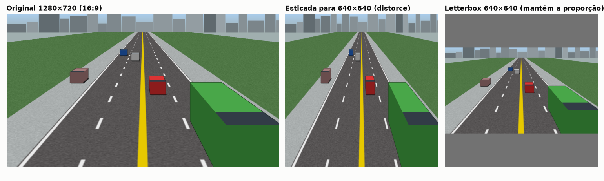

Na interface, o toggle **"Letterbox (manter proporção)"** permite comparar as duas versões ao vivo.

## 3. Transformação de perspectiva (homografia)

O usuário marca **4 pontos de um trecho retangular da pista** e informa a largura e o
comprimento reais. `cv2.getPerspectiveTransform` calcula a matriz 3 × 3 que leva pixels para
metros no plano do chão. Antes disso, o código confere se os pontos formam um quadrilátero convexo,
na ordem certa e com área mínima (sinal do produto vetorial em cada vértice):

```python
# src/geometry/homografia.py
def calcular_homografia(origem_px, largura_m, comprimento_m):
    origem = validar_quadrilatero(origem_px)          # convexo, ordem horária, área mínima
    _validar_medidas(largura_m, comprimento_m)
    destino = np.array([[0, 0], [largura_m, 0], [largura_m, comprimento_m], [0, comprimento_m]],
                       dtype=np.float32)
    matriz = cv2.getPerspectiveTransform(origem, destino).astype(np.float64)
    if not np.all(np.isfinite(matriz)) or abs(np.linalg.det(matriz)) < 1e-12:
        raise HomografiaInvalidaError("Não foi possível calcular a homografia com esses pontos.")
    return matriz

def gerar_birdseye(imagem, matriz_px, tamanho):   # matriz_px = escala (px/m) @ homografia
    return cv2.warpPerspective(imagem, matriz_px, tamanho, flags=cv2.INTER_LINEAR)

def estimar_velocidade_kmh(posicoes_m, tempos_s, dt_minimo_s=0.25):
    ...
    distancia = float(np.linalg.norm(arr[-1] - arr[0]))   # metros, já no plano da pista
    return distancia / dt * 3.6
```

A velocidade usa o **centro da base da caixa** (o contato com o chão), porque a homografia só vale
para pontos no plano da pista. A posição em metros é medida numa janela de 1 s, e não frame a
frame, para que o tremor das caixas não gere picos irreais.

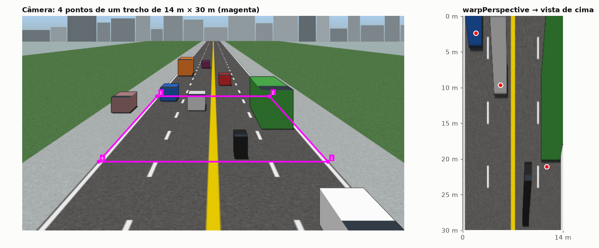

Na vista de cima, as faixas ficam paralelas e os tracejados ficam igualmente espaçados: o chão foi
"desentortado". Os veículos aparecem esticados porque têm altura, e a homografia só é correta para
o plano do chão. Por isso a velocidade usa o ponto da base, marcado em vermelho.

**Velocidade real × estimada na cena sintética** (a cena sabe a velocidade de cada veículo):

| ID | Classe | Real (km/h) | Estimada (km/h) | Erro |
|---|---|---|---|---|
| 1 | carro | 50,0 | 50,4 | +0,8 % |
| 2 | carro | 45,0 | 44,2 | −1,8 % |
| 3 | ônibus | 35,0 | 35,9 | +2,6 % |
| 4 | carro | 55,0 | 56,6 | +2,9 % |
| 5 | moto | 40,0 | 39,9 | −0,3 % |
| 6 | caminhão | 40,0 | 41,3 | +3,3 % |
| 7 | carro | 60,0 | 62,3 | +3,8 % |
| 8 | carro | 50,0 | 50,9 | +1,8 % |

O erro fica abaixo de 4 % com detecções ruidosas. Ele vem do ruído das caixas e de a base da caixa
2D não ser exatamente o ponto de contato do veículo 3D. Em vídeo real, o erro depende sobretudo da
**qualidade da calibração**: medidas reais erradas viram erro proporcional na velocidade. Esse
teste é automatizado em `tests/test_cena_sintetica.py`, com limite de 6 %.

## 4. Composição por camadas com transparência

Cada frame é montado em camadas, sempre na mesma ordem. Cada camada pode ser ligada ou desligada
na interface, ao vivo:

**mapa de calor → ROI → linha de contagem → caixas → trajetórias → vista de cima → HUD**

A transparência usa `cv2.addWeighted`. Para limitar o efeito a uma região, como o polígono da ROI
ou as áreas com calor, a mistura é copiada só onde a **máscara** é diferente de zero:

```python
# src/visualization/desenho.py
def misturar(base, camada, opacidade, mascara=None):
    """base = (1 − α)·base + α·camada, só onde a máscara permite."""
    opacidade = float(np.clip(opacidade, 0.0, 1.0))
    misturada = cv2.addWeighted(camada, opacidade, base, 1.0 - opacidade, 0.0)
    if mascara is None:
        base[:] = misturada
    else:
        cv2.copyTo(misturada, mascara.astype(np.uint8, copy=False), base)
```

```python
# src/visualization/compositor.py — CompositorCamadas.compor() (resumido)
saida = cv2.resize(imagem, self.tamanho_exibicao, interpolation=cv2.INTER_AREA)  # reduz antes de desenhar
if vis.mostrar_heatmap:     self.mapa_calor.sobrepor(saida, vis.opacidade_heatmap, vis.colormap)
if vis.mostrar_roi:         desenhar_roi(saida, self.roi_px, self.escala, vis.opacidade_roi)
if vis.mostrar_linha:       desenhar_linha_contagem(saida, p1, p2, self.escala, ativa)
if vis.mostrar_caixas:      desenhar_caixas(saida, resultado.veiculos, self.escala)
if vis.mostrar_trajetorias: desenhar_trajetorias(saida, ativas, self.escala)
if vis.mostrar_birdseye:    colar_miniatura(saida, self.birdseye.renderizar(imagem, resultado.veiculos))
if vis.mostrar_hud:         desenhar_hud(saida, tabela, fps, latencia)
```

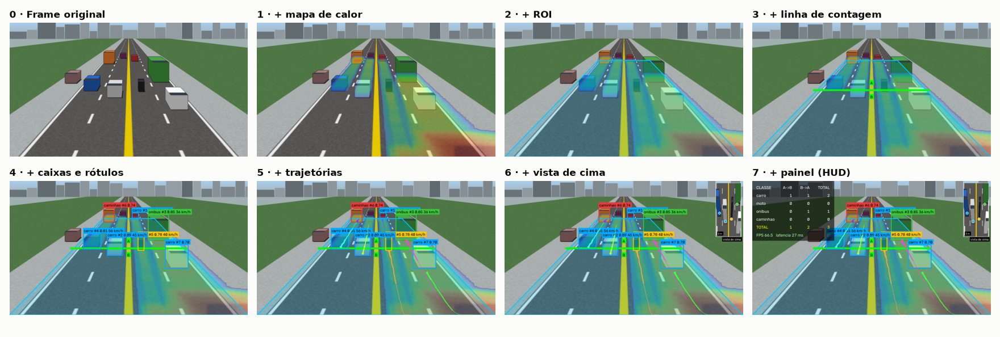

**Decisões de desempenho:**
- A imagem é reduzida para a largura de exibição **antes** de desenhar, então o custo do desenho
  não cresce com vídeos 4K.
- A troca de indexação booleana do NumPy por `cv2.copyTo` com máscara, e do antisserrilhamento no
  preenchimento da ROI, baixou a composição completa de 37 ms para 22 ms por frame, com
  1600 × 1080 e 10 veículos. Antes, só a camada da ROI custava 24 ms.
- O texto do OpenCV (`cv2.putText`) só aceita ASCII, então os rótulos são escritos sem acento
  ("onibus", "caminhao").
- A trajetória é desenhada **depois** das caixas, para não ficar escondida atrás da borda inferior
  delas.

## 5. Mapa de calor com colormap

O mapa acumula a **ocupação** da pista: a cada frame processado, soma 1 numa grade (1 célula a
cada 4 × 4 px) no **terço inferior** de cada caixa, que é a área de pista que o veículo ocupa. A
caixa inteira incluiria a lataria projetada sobre a faixa ao lado. Para exibir, o código:

1. normaliza a grade com **raiz quadrada**, para áreas pouco ocupadas continuarem visíveis;
2. suaviza com `GaussianBlur`;
3. amplia para o tamanho da imagem;
4. aplica o **colormap** (`TURBO` ou `JET`);
5. mistura com a opacidade escolhida, só onde há calor (limiar 8/255).

```python
# src/visualization/mapa_calor.py
def acumular(self, caixas):
    for x1, y1, x2, y2 in caixas:
        y_pegada = y2 - (y2 - y1) * FRACAO_PEGADA            # terço inferior da caixa
        c1, c2 = max(0, int(x1 // r)), min(larg, math.ceil(x2 / r))
        l1, l2 = max(0, int(y_pegada // r)), min(alt, math.ceil(y2 / r))
        if c2 > c1 and l2 > l1:
            self.acumulado[l1:l2, c1:c2] += 1.0

def normalizado(self):
    return (np.sqrt(self.acumulado / self.acumulado.max()) * 255).astype(np.uint8)

def colorir(self, tamanho, colormap="TURBO"):
    grade = cv2.GaussianBlur(self.normalizado(), (5, 5), 0)
    grade = cv2.resize(grade, tamanho, interpolation=cv2.INTER_LINEAR)
    return cv2.applyColorMap(grade, COLORMAPS[colormap]), grade > LIMIAR_EXIBICAO
```

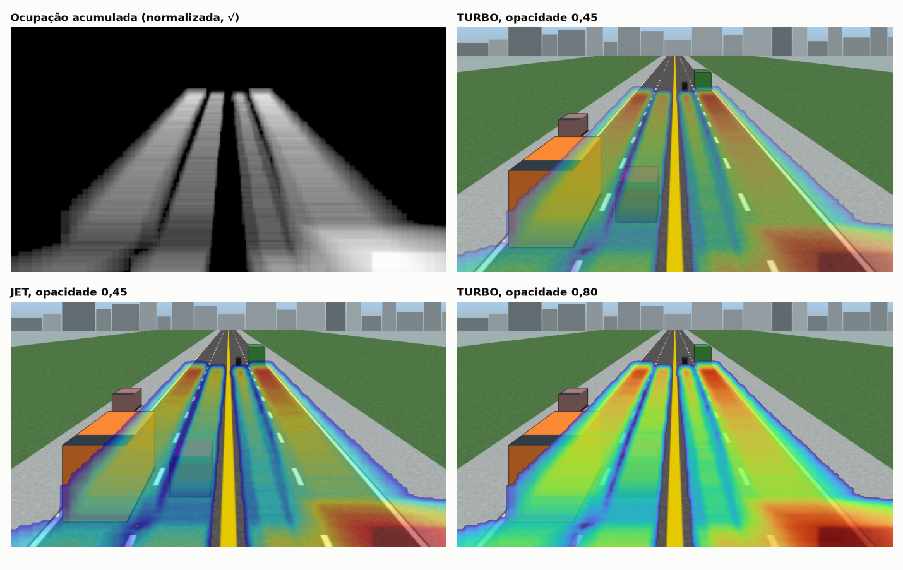

As quatro faixas aparecem separadas, e a faixa central (divisória amarela) fica fria. O canto
inferior direito é o mais quente porque ali os veículos estão perto da câmera e ocupam mais
pixels. O mapa mede **ocupação na imagem**, não densidade por metro. O **TURBO** é o padrão
porque é perceptualmente mais uniforme que o JET, que cria faixas falsas no amarelo e no ciano.

## 6. Desenho de caixas, linhas, trajetórias, polígonos e texto

| Elemento | Primitiva OpenCV | Detalhe |
|---|---|---|
| Caixa | `cv2.rectangle` | cor por **classe** (carro azul, moto laranja, ônibus verde, caminhão vermelho) |
| Rótulo | `cv2.getTextSize` + `cv2.rectangle` + `cv2.putText` | "classe #ID confiança km/h", com fundo na cor da classe; vai para dentro da caixa se não couber acima |
| Trajetória | `cv2.line` segmento a segmento | cor por **ID** (matiz espaçada pela razão áurea); a "cauda" afina no passado |
| Linha de contagem | `cv2.line` + `cv2.circle` | rótulos A e B ao longo da normal (−dy, dx); **pisca em verde** por 12 frames após um cruzamento |
| ROI | `cv2.fillPoly` (máscara) + `addWeighted` + `cv2.polylines` | preenchimento semitransparente e contorno |
| HUD | `cv2.rectangle` + `addWeighted` + `cv2.putText` | tabela classe × sentido, FPS e latência, em colunas de x fixo |

```python
# src/visualization/camadas.py
def desenhar_trajetorias(imagem, trajetorias, escala):
    traco_max = espessura(imagem.shape[1], 1.5)
    for traj in trajetorias:
        pontos = _inteiros(list(traj.pontos), escala)
        cor = cor_id(int(traj.id_rastreio))
        n = len(pontos)
        for i in range(1, n):
            traco = max(1, round(traco_max * i / n))  # "cauda" afinando no passado
            cv2.line(imagem, tuple(pontos[i - 1]), tuple(pontos[i]), cor, traco, cv2.LINE_AA)
        cv2.circle(imagem, tuple(pontos[-1]), traco_max + 1, cor, -1, cv2.LINE_AA)

def linha_piscando(frame_atual, frame_ultimo_cruzamento, duracao):
    decorrido = frame_atual - frame_ultimo_cruzamento
    return 0 <= decorrido < duracao and (decorrido // 2) % 2 == 0   # liga/desliga a cada 2 frames
```

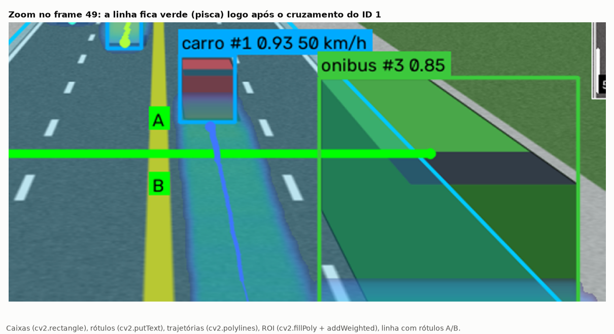

As espessuras e os tamanhos de fonte são proporcionais à largura da imagem (`espessura()`), então o
desenho fica legível tanto em 640 px quanto em 1920 px.

## 7. Atualização em tempo real

A interface processa e mostra **um frame por vez**. A `SessaoAnalise` liga
fonte → pré-processamento → detector → contagem → compositor → gravador, e o Streamlit troca a
imagem num *placeholder* (`st.empty()`) a cada frame, sem recarregar a página:

```python
# app.py — tela_video() (resumido)
area_video = st.empty()
while ss.rodando:
    try:
        passo = sessao.passo()          # lê, analisa e desenha 1 frame
    except ErroAnalise:
        passo = None                    # erro já registrado na sessão; mostra o que foi contado
    if passo is None:                   # fim do vídeo, câmera desconectada ou erro
        ss.rodando = False
        st.rerun()
    area_video.image(passo.imagem_final, channels="BGR", output_format="JPEG")
    if passo.resultado.eventos or sessao.frames_lidos % ATUALIZAR_PAINEIS_A_CADA == 0:
        atualizar_tudo()                # gráfico, tabela de eventos e comparação
    else:
        metricas(sessao, area_metricas) # contagem, FPS e latência a cada frame
```

- **Parâmetros ao vivo:** confiança, IoU, pré-processamentos, camadas e opacidades são objetos
  **compartilhados** entre a interface e a sessão. Mudar um slider durante a análise vale a partir
  do frame seguinte, sem reiniciar.
- **Parâmetros congelados:** linha, ROI, calibração e α são **copiados** no início, para que uma
  contagem não misture duas geometrias.
- **Parar:** o botão usa um *callback* (`on_click`) que encerra a sessão. O rerun do Streamlit
  interrompe o laço, e o vídeo parcial é salvo.
- O gráfico e a tabela são atualizados a cada 10 frames (ou quando alguém é contado), porque
  redesenhá-los a cada frame custaria mais que a própria inferência.
- O frame vai para o navegador como **JPEG**, mais leve que PNG para imagens de câmera.

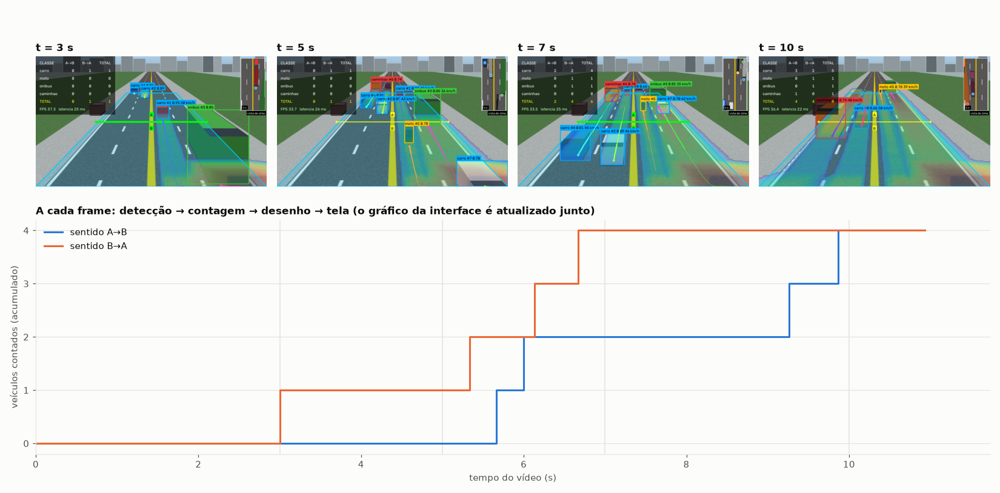

Velocidade medida numa CPU AMD sem GPU, com o pipeline completo: **cerca de 9 FPS com o YOLO11n e
4 FPS com o YOLO11s**. O frame skip aumenta o FPS percebido, porque os frames pulados reaproveitam
as últimas caixas (veja a seção 2.5 de [`pipeline.md`](pipeline.md)).

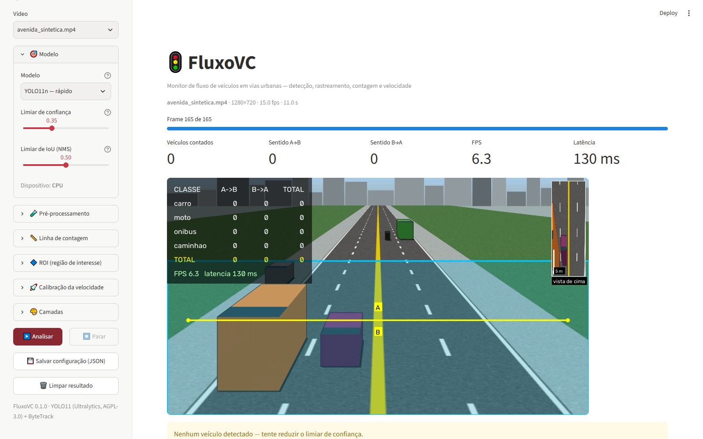

*Print da interface ao fim de uma análise da cena sintética com o YOLO real.* O YOLO não reconhece
as caixas desenhadas como veículos, então a interface mostra o aviso **"Nenhum veículo detectado —
tente reduzir o limiar de confiança"**. Esse é o tratamento de erro previsto para vídeos sem
detecções.

## 8. Suavização de coordenadas (EMA)

As caixas do detector "tremem" de um frame para o outro. A média móvel exponencial, com um estado
por ID, suaviza o ponto de referência antes de desenhar a trajetória e testar o cruzamento:

```python
# src/geometry/suavizacao.py
def ema(anterior, atual, alpha):
    return alpha * np.asarray(atual) + (1 - alpha) * np.asarray(anterior)

class SuavizadorEMA:
    def atualizar(self, id_, ponto):
        bruto = np.asarray(ponto, dtype=np.float64)
        anterior = self._estado.get(id_)
        suave = bruto if anterior is None else ema(anterior, bruto, self.alpha)
        self._estado[id_] = suave
        return float(suave[0]), float(suave[1])
```

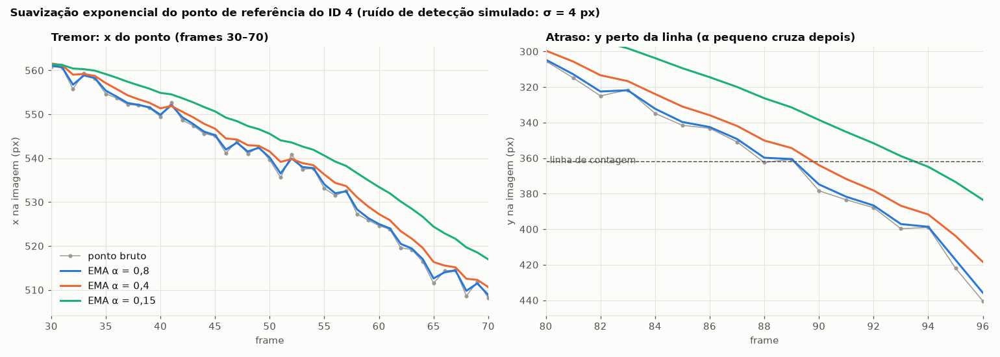

O gráfico mostra o **compromisso** do α:
- **α alto** (0,8) segue o ruído;
- **α baixo** (0,15) fica liso, mas **atrasa**: cruza a linha cerca de 5 frames depois do ponto
  bruto.

O atraso em regime é aproximadamente `(1 − α)/α × deslocamento por frame`. Com **frame skip**, o
deslocamento entre frames processados aumenta, e o atraso também. No teste sintético, um veículo
saiu da ROI antes de o ponto suavizado cruzar a linha e não foi contado (detalhes em
[`metricas.md`](metricas.md#efeito-observado-suavização--frame-skip)). O padrão α = 0,4 equilibra
os dois efeitos. A interface explica isso no texto de ajuda do slider.

## 9. ROI (região de interesse)

A ROI é um polígono em coordenadas normalizadas, editável na barra lateral. Ela age em **dois
lugares**:

1. **Antes do modelo:** tudo o que está fora do polígono é pintado de cinza na entrada do YOLO, que
   não gasta detecções com calçadas e estacionamentos.
2. **Depois do modelo:** uma detecção só é aceita se o **ponto de referência** estiver dentro do
   polígono (`cv2.pointPolygonTest`). Isso descarta veículos cortados pela borda da máscara.

```python
# src/preprocessing/operacoes.py
def criar_mascara_roi(forma, poligono_px):
    mascara = np.zeros(forma[:2], dtype=np.uint8)
    cv2.fillPoly(mascara, [np.asarray(poligono_px, dtype=np.int32).reshape(-1, 1, 2)], 255)
    return mascara

def aplicar_mascara(imagem, mascara, cor=COR_PREENCHIMENTO):
    saida = imagem.copy()
    saida[mascara == 0] = cor
    return saida

# src/geometry/roi.py
def ponto_na_roi(ponto, poligono_px):
    contorno = np.asarray(poligono_px, dtype=np.float32).reshape(-1, 1, 2)
    return cv2.pointPolygonTest(contorno, (float(ponto[0]), float(ponto[1])), False) >= 0
```

O polígono é validado antes do uso: pelo menos 3 pontos, valores entre 0 e 1 e área mínima, o que
rejeita pontos alinhados. Uma ROI inválida aparece como **erro** na prévia e impede a análise. Ela
é convertida para o espaço do modelo com a mesma `original_para_modelo` do requisito 1.

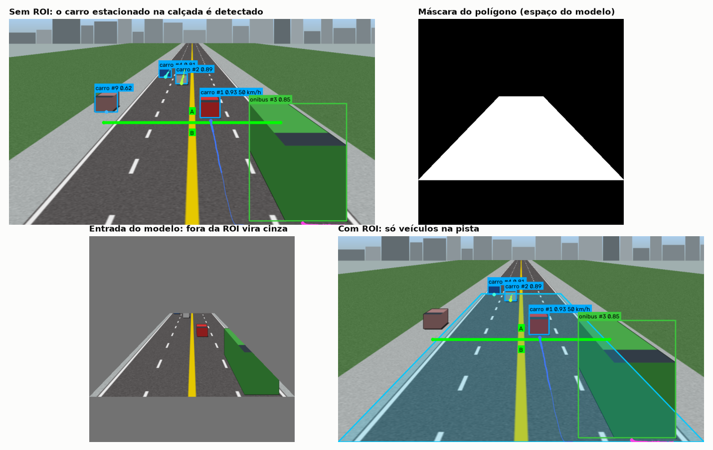

Sem ROI, o carro estacionado na calçada (ID 9) é detectado e entraria no mapa de calor. Com a ROI,
ele é ignorado.

## 10. Comparação original × processada × final

A interface mostra, lado a lado, o **frame original**, a **entrada do modelo** (depois do
pré-processamento) e o **resultado final**. Fica num painel expansível durante a análise e é fixo
na análise de imagem única. A função `painel_comparacao` monta a mesma comparação numa imagem só,
para relatórios:

```python
# src/visualization/compositor.py
def painel_comparacao(original, preprocessado, final, altura=320, titulos=(...)):
    paineis = []
    for imagem, titulo in zip((original, preprocessado, final), titulos):
        ajustada = _ajustar_altura(imagem, altura)                  # mesma altura, proporção mantida
        cabecalho = np.full((faixa_titulo, ajustada.shape[1], 3), 30, dtype=np.uint8)
        escrever(cabecalho, titulo, (8, 19), 0.5, BRANCO, fundo=None)
        paineis.append(np.vstack((cabecalho, ajustada)))
    ...
    return np.hstack(partes)                                        # com separadores brancos
```

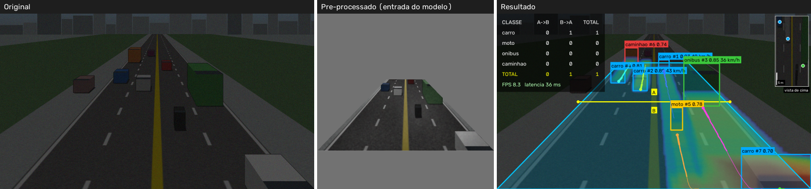

Na versão "anoitecer" da cena (escura e com ruído de sensor), a entrada do modelo passa por
letterbox, **CLAHE**, **filtro bilateral** e **ROI**. O efeito de cada etapa, ampliado:

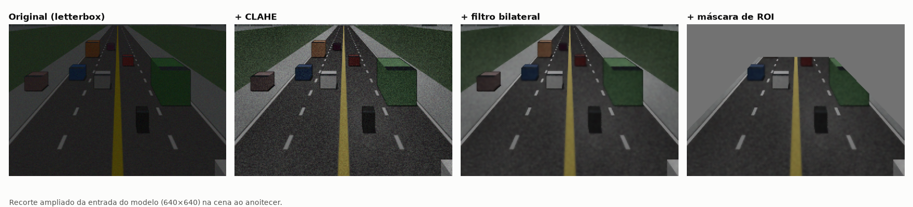

- **CLAHE** no canal L do espaço LAB recupera o contraste sem mudar as cores dos veículos, mas
  também realça o ruído.
- O **filtro bilateral** reduz o ruído preservando as bordas.
- A **máscara de ROI** remove o que não é pista.

Os detalhes e o motivo da ordem dessas etapas estão em [`pipeline.md`](pipeline.md#2-pré-processamento--srcpreprocessing).

---

## Como regenerar as figuras

```bash
python scripts/gerar_figuras.py            # cerca de 40 s; inclui docs/img/demo.gif
python scripts/gerar_figuras.py --sem-gif
```

O resultado é determinístico (sementes fixas). Os prints da interface (`docs/img/interface_*.png`)
foram feitos com o app rodando de verdade (`streamlit run app.py`). Quando a equipe tiver o vídeo
real, vale acrescentar prints da análise com detecções reais.
