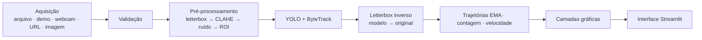

# Pipeline do FluxoVC

> Documento construído ao longo das fases do projeto.

## 1. Aquisição e validação — `src/acquisition/`

| Fonte | Função | Observações |
|---|---|---|
| Upload de vídeo (mp4/avi/mov) | `salvar_upload` + `abrir_arquivo` | gravado na pasta temporária do sistema com nome seguro |
| Vídeo de demonstração | `listar_videos_demo` + `abrir_arquivo` | arquivos em `data_samples/` |
| Webcam | `abrir_webcam(indice)` | DirectShow no Windows; timestamp pelo relógio |
| URL / câmera IP | `abrir_url` | http, https, rtsp, rtmp; tempo limite de 8 s |
| Imagem única (jpg/png) | `decodificar_imagem` / `carregar_imagem` | análise estática |

Toda abertura valida: existência, extensão, tamanho (vazio / acima do limite), se abre no
`cv2.VideoCapture`, se o **primeiro frame é realmente lido**, resolução mínima (320×240) e FPS
(0, negativo, NaN ou > 240 → fallback de 30 fps). Falhas viram exceções com mensagem em português
(`ArquivoInvalidoError`, `WebcamIndisponivelError`, `FonteInvalidaError`).

## 2. Pré-processamento — `src/preprocessing/`

Ordem aplicada por `preprocessar()`: **letterbox → CLAHE → redução de ruído → máscara de ROI**.

- O letterbox vem primeiro: as demais operações passam a trabalhar sempre num quadrado de
  640×640, com custo constante mesmo para vídeos Full HD ou 4K.
- A ROI vem por último, para que o CLAHE e o filtro não espalhem a borda artificial da máscara
  para dentro da pista.
- A imagem resultante é exatamente o que o modelo recebe; é ela que aparece no painel
  "pré-processado" da comparação original × pré-processado × final.
- O tempo de cada etapa (ms) é medido e devolvido em `ResultadoPreproc.tempos_ms`.

Cada operação tem um toggle na interface; os textos de ajuda vêm de `EXPLICACOES` em
`src/preprocessing/pipeline.py`.

### 2.1 Redimensionamento com letterbox (`manter_proporcao`)

**O quê:** reduz (ou amplia) o frame com a mesma escala nos dois eixos,
`s = min(640/largura, 640/altura)`, e centraliza o resultado num quadrado 640×640; as sobras
viram faixas cinzas (114, 114, 114), a mesma cor usada no treino do YOLO.

**Por quê:** o YOLO espera uma entrada quadrada. Esticar um frame 16:9 para 1:1 achata os
veículos e muda a forma que o modelo aprendeu a reconhecer. O toggle desligado faz exatamente
isso (estica), para comparação.

**Interpolação:** `INTER_AREA` ao reduzir (evita serrilhado) e `INTER_LINEAR` ao ampliar.

**Inverso:** as caixas detectadas voltam ao frame original por
`x_orig = (x_modelo − pad_x) / escala_x` (ver §3.1).

### 2.2 Máscara de ROI (`usar_roi`)

**O quê:** um polígono (≥ 3 pontos, em coordenadas normalizadas) marca a pista. A máscara é
desenhada com `cv2.fillPoly` e tudo fora dela é pintado de cinza.

**Por quê:** evita detectar carros estacionados, pedestres na calçada (a classe pessoa já é
ignorada) ou veículos de outra via, e reduz falsos positivos.

**Validação:** menos de 3 pontos, pontos fora de [0, 1] ou polígono sem área geram
`RoiInvalidaError` com mensagem para o usuário.

### 2.3 CLAHE no canal L (`usar_clahe`, `clahe_clip`, `clahe_grade`)

**O quê:** converte BGR → LAB, aplica equalização de histograma adaptativa com limite de
contraste (CLAHE) só no canal **L** (luminância) e volta para BGR.

**Por quê:** cenas noturnas, sombras de prédios e contraluz deixam veículos com pouco contraste.
O CLAHE equaliza por blocos (`grade × grade`), e o `clip` limita o quanto o ruído é amplificado.
Equalizar R, G e B separadamente alteraria a cor dos veículos; no LAB a cor (canais a e b) fica
intacta.

### 2.4 Redução de ruído (`usar_reducao_ruido`, `tipo_filtro`, `kernel_ruido`)

**O quê:** filtro **bilateral** (padrão) ou **gaussiano**, com kernel ímpar configurável
(valores pares são arredondados para o ímpar seguinte).

**Por quê:** câmeras baratas e vídeos muito comprimidos têm ruído e blocos de compressão que geram
detecções instáveis. O bilateral pondera pela distância **e** pela diferença de cor, então
suaviza o asfalto sem borrar as bordas dos veículos; o gaussiano é mais rápido, mas borra tudo.

### 2.5 Frame skipping (opcional, `frame_skip`)

Com `frame_skip = N`, processa 1 frame e pula os N seguintes (`deve_processar_frame`). Aumenta o
FPS em CPU, mas veículos rápidos andam mais entre dois frames processados, o que piora o
rastreamento. O ganho real é medido na Fase 6.

## 3. Geometria — `src/geometry/`

### 3.1 Espaços de coordenadas

| Espaço | Exemplo | Uso |
|---|---|---|
| Normalizado | (0,5; 0,6) | configuração da linha, ROI e homografia |
| Original | 1920×1080 | trajetórias, contagem, velocidade, desenho |
| Modelo | 640×640 | entrada/saída do YOLO |
| Exibição | 960×540 | imagem mostrada na interface |

Convenção contínua: o pixel `i` ocupa `[i, i+1)`. Funções: `original_para_modelo`,
`modelo_para_original` (letterbox inverso, com recorte nas faixas), `caixas_modelo_para_original`,
`original_para_exibicao`, `normalizados_para_pixels`. Testes garantem ida e volta com erro ≤ 1 px,
inclusive aplicando o letterbox numa imagem real e reencontrando um objeto desenhado.

### 3.2 Homografia — vista de cima e velocidade

O usuário marca 4 pontos da pista (sup. esq., sup. dir., inf. dir., inf. esq.) e informa
largura e comprimento reais do trecho em metros. `cv2.getPerspectiveTransform` calcula a matriz
3×3 `H` que leva pixels para metros no plano da pista. Multiplicando `H` por uma escala (pixels
por metro), `cv2.warpPerspective` gera a vista "bird's-eye".

A velocidade é a distância em metros entre a primeira e a última posição de uma janela de
tempo, dividida pelo Δt (× 3,6 para km/h). Usar a janela, e não frame a frame, evita picos
causados pelo tremor das caixas.

**Validação (homografia degenerada):** exige 4 pontos formando um quadrilátero convexo, sem três
pontos alinhados, sem cruzamento (testado pelo sinal do produto vetorial entre arestas
consecutivas) e com área mínima, além de medidas positivas. Caso contrário,
`HomografiaInvalidaError`.

**Limitação:** só vale para pontos no plano da pista. Por isso a posição do veículo será o centro
da base da caixa (contato com o chão), não o centro da caixa.

### 3.3 Suavização de trajetórias (EMA)

`s_t = α·p_t + (1 − α)·s_{t−1}`, com um estado por ID (`SuavizadorEMA`). α próximo de 1 segue o
ponto bruto; próximo de 0 suaviza mais, mas atrasa a trajetória. Nos testes, α = 0,3 reduz o
tremor vertical de uma trajetória ruidosa em mais de 50%.

## 4. Detecção, rastreamento e contagem — `src/models/`

### 4.1 Detector (`detector_yolo.py`)

`DetectorYOLO` envolve o YOLO11 (Ultralytics, AGPL-3.0, pesos pré-treinados no COCO) com o
rastreador **ByteTrack** embutido: `model.track(imagem, persist=True, tracker="bytetrack.yaml")`.

- Filtra só as classes de veículo do COCO: carro (2), moto (3), ônibus (5) e caminhão (7). Pessoas
  nunca são processadas.
- Recebe a imagem já pré-processada (640×640). Como ela já tem o tamanho de entrada, o letterbox
  interno do Ultralytics não muda nada, e as caixas voltam no mesmo espaço que enviamos.
- Confiança e IoU/NMS são lidos da configuração a cada frame: a interface muda esses valores sem
  recarregar o modelo.
- Usa GPU (CUDA) se houver, senão CPU. Os pesos são baixados para `pesos/`, que fica fora do git.
  Sem internet, a mensagem indica o link para download manual.
- `reiniciar()` zera o ByteTrack ao trocar de vídeo, para os IDs recomeçarem em 1.

O analisador depende só do contrato `Detector` (`tipos.py`). Os testes injetam detectores falsos
e rodam a pipeline inteira sem baixar pesos.

### 4.2 Interpretação das saídas (`analisador.py`)

Para cada frame processado:

1. **Letterbox inverso:** as caixas saem do espaço 640×640 e voltam ao frame original (§3.1).
   Caixas inteiras dentro da faixa cinza são descartadas.
2. **Filtros:** classe de veículo, confiança mínima e ROI. A ROI é testada pelo ponto de
   referência do veículo com `cv2.pointPolygonTest`.
3. **Ponto de referência:** por padrão, o **centro da base da caixa**, que é o contato com o chão.
   Esse é o ponto correto para a homografia, que só vale no plano da pista. Pode ser trocado para
   o centro da caixa.
4. **Histórico por ID** (`rastreamento.py`): guarda as últimas posições suavizadas por EMA, os
   votos de classe e a velocidade. A classe exibida é a mais votada, porque o detector às vezes
   alterna entre carro e caminhão no mesmo veículo. IDs não vistos por 30 frames são descartados.
5. **Velocidade:** a posição suavizada vai para metros pela homografia. A velocidade é a média na
   última janela de 1 s, medida só dentro do quadrilátero calibrado, já que fora dele a homografia
   extrapola. Homografia inválida desativa só a velocidade, com aviso; a contagem continua.
6. **Contagem:** cruzamento da linha virtual (§4.3).

O tempo de cada etapa (pré-processamento, inferência e interpretação) é medido em todo frame.
Com `frame_skip`, os frames pulados repetem os veículos do último frame processado.

### 4.3 Cruzamento da linha (`contagem.py`)

Para a linha de `A` até `B`, o produto vetorial `lado(P) = (B − A) × (P − A)` é positivo de um lado,
negativo do outro e zero sobre a linha. Um ID é contado quando:

- o sinal muda entre a última posição **fora da linha** e a atual (parar sobre a linha não decide
  nada); e
- o deslocamento corta o **segmento** AB, e não apenas o prolongamento da reta. O teste é feito
  com o mesmo produto vetorial, invertendo os papéis.

Cada ID é contado **uma única vez**, então o tremor da caixa sobre a linha não duplica a contagem.
Sentido **A→B** = do lado negativo para o positivo; **B→A** = o contrário. Numa linha horizontal
desenhada da esquerda para a direita, A→B é de cima para baixo.

Cada evento registra: ID, classe, sentido, frame, instante (s) e velocidade (km/h).

### 4.4 Desempenho medido (prévia)

CPU, yolo11n, frame 1400×1080: cerca de 14 ms de pré-processamento, 127 ms de inferência e
menos de 1 ms de interpretação por frame, ou seja, uns 7 FPS. A comparação completa (n × s,
com e sem frame skip) será feita na Fase 6.

## 5. Camadas gráficas — `src/visualization/`

`CompositorCamadas.compor()` monta o frame exibido. Primeiro o frame original é **reduzido para a
largura de exibição** (960 px por padrão): desenhar depois de reduzir é mais barato e mantém a
espessura do traço constante na tela. Todas as coordenadas (que estão no espaço original) passam
por `original_para_exibicao`, a última etapa do mapeamento modelo → original → interface.

Ordem das camadas, de baixo para cima (cada uma liga e desliga em `VisualizacaoConfig`):

| # | Camada | Técnica |
|---|---|---|
| 1 | Mapa de calor | grade de ocupação acumulada → `applyColorMap` (TURBO/JET) → `addWeighted` só onde há calor |
| 2 | ROI | polígono preenchido com transparência (`addWeighted` + máscara) e contorno |
| 3 | Linha de contagem | `cv2.line` com marcação dos lados A e B; pisca em verde e engrossa por 12 frames após um cruzamento |
| 4 | Caixas | cor por classe e rótulo com classe, ID, confiança e km/h |
| 5 | Trajetórias | polilinha suavizada (EMA) com cor por ID; o traço afina em direção ao passado |
| 6 | Bird's-eye | `warpPerspective` do trecho calibrado em miniatura, com veículos e régua de 5 m |
| 7 | Painel HUD | contagem por classe e sentido, FPS e latência, em fundo semitransparente |

As trajetórias ficam acima das caixas porque o ponto de referência é o centro da base da caixa:
num movimento horizontal, a borda inferior da caixa esconderia a trajetória.

**Detalhes:**

- **Cor por ID:** a matiz avança pela razão áurea (`h = id · 0,618 mod 1`). Assim, IDs vizinhos
  recebem cores bem diferentes, e cada ID mantém a mesma cor em todos os frames.
- **Mapa de calor:** a cada frame processado, soma +1 na **pegada** de cada veículo (terço inferior
  da caixa, a parte que toca o asfalto), numa grade de 1/4 da resolução. Antes de colorir, a grade
  é normalizada pela raiz quadrada (`√(v/máx)`), para realçar as faixas pouco usadas, e suavizada
  com um filtro gaussiano. O mapa acumula mesmo com a camada desligada; ao ligá-la, o histórico já
  aparece.
- **Texto sem acento no vídeo:** `cv2.putText` usa fontes Hershey, que só têm ASCII. Desenhar com
  Pillow exigiria converter o frame inteiro a cada quadro, então o texto **sobre o vídeo** é escrito
  sem acentos (`texto_ascii`). A interface mantém a acentuação.
- **HUD alinhado:** como a fonte não é monoespaçada, cada célula da tabela é escrita numa coluna de
  `x` fixo, calculado com `cv2.getTextSize`.
- **Desempenho:** a transparência com máscara usa `cv2.copyTo`, cerca de 10× mais rápido que a
  indexação booleana do NumPy. Isso baixou o desenho de 37 para 22 ms por frame (1600×1080 com 10
  veículos e todas as camadas), bem abaixo dos ~127 ms da inferência em CPU.

### 5.1 Comparação original × pré-processado × final

`painel_comparacao()` coloca as três imagens lado a lado, na mesma altura e com títulos: o frame
original, a entrada do modelo (640×640, com letterbox, ROI e demais filtros) e o resultado com as
camadas. Assim dá para ver o efeito de cada toggle de pré-processamento.

## 6. Interface Streamlit — `app.py` e `src/aplicacao/`

`app.py` contém **só a interface**. A lógica fica em `src/aplicacao/`:

- `SessaoAnalise` liga fonte → analisador → compositor → gravador e processa um frame por chamada
  de `passo()`. A sessão fica no `st.session_state`; assim o laço pode ser interrompido (botão Parar
  ou mudança de parâmetro) e retomado sem perder trajetórias nem contagens.
- `relatorios.py` gera as tabelas: eventos, resumo por classe e sentido, série acumulada para o
  gráfico e CSV no padrão brasileiro (`;` e vírgula decimal, UTF-8 com BOM, que abre direto no Excel).

### 6.1 Barra lateral

| Grupo | Controles |
|---|---|
| Fonte | vídeo de demonstração (`data_samples/`), upload (mp4/avi/mov), webcam (índice), URL/câmera IP, imagem única (jpg/png) |
| Modelo | YOLO11n ou YOLO11s, limiar de confiança, limiar de IoU (NMS); mostra se está em CPU ou GPU |
| Pré-processamento | toggles de letterbox, ROI, CLAHE (limite e grade) e redução de ruído (filtro e kernel); frame skip. A ajuda de cada toggle vem de `EXPLICACOES` |
| Linha de contagem | coordenadas normalizadas de A e B; ponto do veículo (base ou centro) |
| ROI | tabela editável de pontos (adicionar e remover linhas) |
| Calibração | 4 pontos da pista, largura e comprimento reais (m), α da EMA |
| Camadas | 7 toggles, opacidade do mapa de calor e da ROI, colormap TURBO ou JET |

**Ao vivo × na próxima análise:** confiança, IoU, pré-processamento e camadas mudam **durante** a
análise; o detector e o compositor leem a configuração a cada frame. Linha, ROI, calibração e α
ficam bloqueados enquanto a análise roda e valem a partir da próxima, para uma mesma contagem não
misturar geometrias diferentes (`config_da_sessao`).

### 6.2 Área principal

- **Antes de analisar:** prévia do primeiro frame com a ROI, a linha (lados A e B) e o
  quadrilátero de calibração numerado de 1 a 4. Erros de configuração (ROI com menos de 3 pontos,
  linha degenerada) e avisos (homografia inválida → sem velocidade) aparecem antes de começar.
- **Durante:** barra de progresso, métricas (total, por sentido, FPS e latência), vídeo processado
  quadro a quadro (em JPEG, mais rápido que PNG) e alerta de "nenhum veículo detectado". A cada 10
  frames, ou quando alguém cruza a linha, também são atualizados o gráfico de contagem acumulada, a
  tabela de eventos e a comparação original × pré-processado × resultado.
- **Depois:** resumo por classe e sentido, FPS médio, tempo médio por etapa (ms) e downloads:
  eventos (CSV), resumo (CSV) e vídeo processado (MP4). O vídeo é gravado em H.264 (`avc1`) quando o
  OpenCV da máquina permite, e aí também pode ser assistido no navegador; senão, em `mp4v`, que
  serve só para download.
- **Imagem única:** comparação nas três colunas, contagem por classe, tabela de detecções e download
  da imagem anotada (PNG) e do CSV.

### 6.3 Detalhes de implementação

- **Detector reaproveitado:** carregar o YOLO é caro. O detector fica guardado na sessão do
  navegador, um por modelo, e é reiniciado (ByteTrack zerado) a cada nova análise.
- **Atualização da barra lateral:** depois de iniciar e ao terminar a análise, `st.rerun()`
  redesenha a barra lateral. Sem isso, o botão Parar apareceria desabilitado durante a análise,
  porque a barra lateral é desenhada antes de a análise começar.
- **Privacidade:** `.streamlit/config.toml` desliga o envio de estatísticas de uso do Streamlit.
- **Testes:** `tests/test_aplicacao.py` roda o `app.py` real com o `AppTest` do Streamlit. O
  vídeo sintético entra como vídeo de demonstração e o detector falso é injetado na sessão; o teste
  ajusta a linha, clica em Analisar e confere a contagem nas métricas da página.

## 7. Métricas e avaliação — `src/metrics/` e `scripts/`

Ver [metricas.md](metricas.md) para as definições, o preparo da referência manual e o passo a
passo de anotação. Resultados em [resultados.md](resultados.md), gerado por
`python scripts/evaluate.py`.

| Módulo | Conteúdo |
|---|---|
| `qualidade.py` | IoU, casamento guloso previsão × anotação, precisão/recall/F1, erro de contagem, MAE, estabilidade do rastreamento |
| `anotacoes.py` | leitura da contagem manual (CSV) e dos rótulos YOLO exportados pelo CVAT ou Label Studio |
| `desempenho.py` | FPS (EMA), memória (RSS via `psutil`), resumo dos tempos por etapa (média e p95) |
| `avaliacao.py` | roda um vídeo com uma configuração e avalia a detecção nos frames anotados |
| `relatorio.py` | tabelas Markdown, gráficos (matplotlib) e o `docs/resultados.md` |

## 8. Tratamento de erros

Nenhum erro previsto derruba a interface. Cada caso vira uma mensagem em português, e o detalhe
técnico vai para o log do terminal (`logging`). Na interface, erros inesperados são registrados com
`logger.exception` e aparecem ao usuário como uma mensagem genérica.

| Situação | Onde é detectada | O que o usuário vê | Teste |
|---|---|---|---|
| Arquivo inexistente, vazio, extensão errada ou maior que o limite | `acquisition/validacao.py` | erro explicando o problema | `test_aquisicao.py` |
| Vídeo corrompido, sem frames ou com resolução menor que 320 × 240 | `acquisition/fontes.py` | erro na prévia, sem travar | `test_aquisicao.py`, `test_erros.py` |
| FPS ausente ou absurdo (0, NaN, > 240) | `validacao.fps_valido` | usa 30 fps e marca "(estimado)" | `test_aquisicao.py` |
| Webcam ausente ou ocupada | `fontes.abrir_webcam` | "Não foi possível acessar a câmera…" | `test_erros.py` |
| URL inválida ou inacessível | `fontes.validar_url` / `abrir_url` (timeout de 8 s) | erro com o motivo | `test_aquisicao.py` |
| Câmera desconectada ou stream encerrado no meio | `SessaoAnalise.passo` | aviso, e os resultados até ali ficam disponíveis | `test_erros.py` |
| Nenhum veículo detectado | `AnalisadorFluxo.sem_deteccoes` | "Nenhum veículo detectado — tente reduzir o limiar de confiança." | `test_erros.py` |
| ROI com menos de 3 pontos, fora do frame ou sem área | `geometry/roi.validar_roi` | erro na prévia; a análise não começa | `test_geometria.py`, `test_aplicacao.py` |
| Linha de contagem com os dois pontos iguais | `ContadorLinha` | erro na prévia | `test_contagem.py` |
| Homografia degenerada (pontos fora de ordem, cruzados, alinhados ou medidas ≤ 0) | `geometry/homografia.validar_quadrilatero` | aviso: só a **velocidade** é desativada, a contagem continua | `test_geometria.py`, `test_erros.py` |
| Pesos sem internet na primeira execução | `DetectorYOLO._carregar` | link para baixar manualmente e a pasta onde salvar | `test_detector_yolo.py`, `test_erros.py` |
| Pesos corrompidos | `DetectorYOLO._carregar` | orienta a apagar o arquivo para baixar de novo | `test_detector_yolo.py` |
| Erro inesperado no meio da análise (ex.: falta de memória) | `SessaoAnalise.passo` → `ErroAnalise` | mensagem com o frame do erro; a sessão é encerrada, o vídeo parcial e a contagem ficam disponíveis | `test_erros.py` |
| Falha ao gravar o MP4 (disco cheio, sem permissão, sem codec) | `SessaoAnalise._gravar` | aviso; a análise continua sem o vídeo | `test_erros.py` |
| Contagem manual ou anotação YOLO malformada (no `evaluate.py`) | `metrics/anotacoes.py` | aviso no relatório; a parte inválida é ignorada | `test_metricas.py`, `test_avaliacao.py` |
