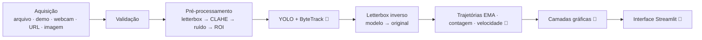

# Pipeline do FluxoVC

> Documento construído ao longo das fases. Seções marcadas com 🚧 serão completadas nas fases seguintes.

## 1. Aquisição e validação — `src/acquisition/`

| Fonte | Função | Observações |
|---|---|---|
| Upload de vídeo (mp4/avi/mov) | `salvar_upload` + `abrir_arquivo` | gravado na pasta temporária do sistema com nome seguro |
| Vídeo de demonstração | `listar_videos_demo` + `abrir_arquivo` | arquivos em `data_samples/` |
| Webcam | `abrir_webcam(indice)` | DirectShow no Windows; timestamp pelo relógio |
| URL / câmera IP | `abrir_url` | http, https, rtsp, rtmp; tempo limite de 8 s |
| Imagem única (jpg/png) | `decodificar_imagem` / `carregar_imagem` | análise estática |

Toda abertura valida: existência, extensão, tamanho (vazio / acima do limite), se abre no
`cv2.VideoCapture`, se o **primeiro frame é realmente lido**, resolução mínima (320×240) e FPS
(0, negativo, NaN ou > 240 → fallback de 30 fps). Falhas viram exceções com mensagem em português
(`ArquivoInvalidoError`, `WebcamIndisponivelError`, `FonteInvalidaError`).

## 2. Pré-processamento — `src/preprocessing/`

Ordem aplicada por `preprocessar()`: **letterbox → CLAHE → redução de ruído → máscara de ROI**.

- O letterbox vem primeiro: as demais operações passam a trabalhar sempre num quadrado de
  640×640, com custo constante mesmo para vídeos Full HD ou 4K.
- A ROI vem por último, para que o CLAHE e o filtro não espalhem a borda artificial da máscara
  para dentro da pista.
- A imagem resultante é exatamente o que o modelo recebe; é ela que aparece no painel
  "pré-processado" da comparação original × pré-processado × final.
- O tempo de cada etapa (ms) é medido e devolvido em `ResultadoPreproc.tempos_ms`.

Cada operação tem um toggle na interface; os textos de ajuda vêm de `EXPLICACOES` em
`src/preprocessing/pipeline.py`.

### 2.1 Redimensionamento com letterbox (`manter_proporcao`)

**O quê:** reduz (ou amplia) o frame com a mesma escala nos dois eixos,
`s = min(640/largura, 640/altura)`, e centraliza o resultado num quadrado 640×640; as sobras
viram faixas cinzas (114, 114, 114), a mesma cor usada no treino do YOLO.

**Por quê:** o YOLO espera uma entrada quadrada. Esticar um frame 16:9 para 1:1 achata os
veículos e muda a forma que o modelo aprendeu a reconhecer. O toggle desligado faz exatamente
isso (estica), para comparação.

**Interpolação:** `INTER_AREA` ao reduzir (evita serrilhado) e `INTER_LINEAR` ao ampliar.

**Inverso:** as caixas detectadas voltam ao frame original por
`x_orig = (x_modelo − pad_x) / escala_x` (ver §3.1).

### 2.2 Máscara de ROI (`usar_roi`)

**O quê:** um polígono (≥ 3 pontos, em coordenadas normalizadas) marca a pista. A máscara é
desenhada com `cv2.fillPoly` e tudo fora dela é pintado de cinza.

**Por quê:** evita detectar carros estacionados, pedestres na calçada (a classe pessoa já é
ignorada) ou veículos de outra via, e reduz falsos positivos.

**Validação:** menos de 3 pontos, pontos fora de [0, 1] ou polígono sem área geram
`RoiInvalidaError` com mensagem para o usuário.

### 2.3 CLAHE no canal L (`usar_clahe`, `clahe_clip`, `clahe_grade`)

**O quê:** converte BGR → LAB, aplica equalização de histograma adaptativa com limite de
contraste (CLAHE) só no canal **L** (luminância) e volta para BGR.

**Por quê:** cenas noturnas, sombras de prédios e contraluz deixam veículos com pouco contraste.
O CLAHE equaliza por blocos (`grade × grade`), e o `clip` limita o quanto o ruído é amplificado.
Equalizar R, G e B separadamente alteraria a cor dos veículos; no LAB a cor (canais a e b) fica
intacta.

### 2.4 Redução de ruído (`usar_reducao_ruido`, `tipo_filtro`, `kernel_ruido`)

**O quê:** filtro **bilateral** (padrão) ou **gaussiano**, com kernel ímpar configurável
(valores pares são arredondados para o ímpar seguinte).

**Por quê:** câmeras baratas e vídeos muito comprimidos têm ruído e blocos de compressão que geram
detecções instáveis. O bilateral pondera pela distância **e** pela diferença de cor, então
suaviza o asfalto sem borrar as bordas dos veículos; o gaussiano é mais rápido, mas borra tudo.

### 2.5 Frame skipping (opcional, `frame_skip`)

Com `frame_skip = N`, processa 1 frame e pula os N seguintes (`deve_processar_frame`). Aumenta o
FPS em CPU, mas veículos rápidos andam mais entre dois frames processados, o que piora o
rastreamento. O ganho real é medido na Fase 6.

## 3. Geometria — `src/geometry/`

### 3.1 Espaços de coordenadas

| Espaço | Exemplo | Uso |
|---|---|---|
| Normalizado | (0,5; 0,6) | configuração da linha, ROI e homografia |
| Original | 1920×1080 | trajetórias, contagem, velocidade, desenho |
| Modelo | 640×640 | entrada/saída do YOLO |
| Exibição | 960×540 | imagem mostrada na interface |

Convenção contínua: o pixel `i` ocupa `[i, i+1)`. Funções: `original_para_modelo`,
`modelo_para_original` (letterbox inverso, com recorte nas faixas), `caixas_modelo_para_original`,
`original_para_exibicao`, `normalizados_para_pixels`. Testes garantem ida e volta com erro ≤ 1 px,
inclusive aplicando o letterbox numa imagem real e reencontrando um objeto desenhado.

### 3.2 Homografia — vista de cima e velocidade

O usuário marca 4 pontos da pista (sup. esq., sup. dir., inf. dir., inf. esq.) e informa
largura e comprimento reais do trecho em metros. `cv2.getPerspectiveTransform` calcula a matriz
3×3 `H` que leva pixels para metros no plano da pista. Multiplicando `H` por uma escala (pixels
por metro), `cv2.warpPerspective` gera a vista "bird's-eye".

A velocidade é a distância em metros entre a primeira e a última posição de uma janela de
tempo, dividida pelo Δt (× 3,6 para km/h). Usar a janela, e não frame a frame, evita picos
causados pelo tremor das caixas.

**Validação (homografia degenerada):** exige 4 pontos formando um quadrilátero convexo, sem três
pontos alinhados, sem cruzamento (testado pelo sinal do produto vetorial entre arestas
consecutivas) e com área mínima, além de medidas positivas. Caso contrário,
`HomografiaInvalidaError`.

**Limitação:** só vale para pontos no plano da pista. Por isso a posição do veículo será o centro
da base da caixa (contato com o chão), não o centro da caixa.

### 3.3 Suavização de trajetórias (EMA)

`s_t = α·p_t + (1 − α)·s_{t−1}`, com um estado por ID (`SuavizadorEMA`). α próximo de 1 segue o
ponto bruto; próximo de 0 suaviza mais, mas atrasa a trajetória. Nos testes, α = 0,3 reduz o
tremor vertical de uma trajetória ruidosa em mais de 50%.

## 4. Detecção, rastreamento e contagem 🚧

## 5. Camadas gráficas 🚧
