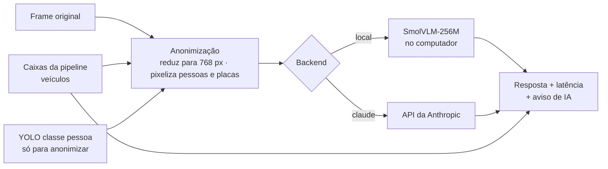
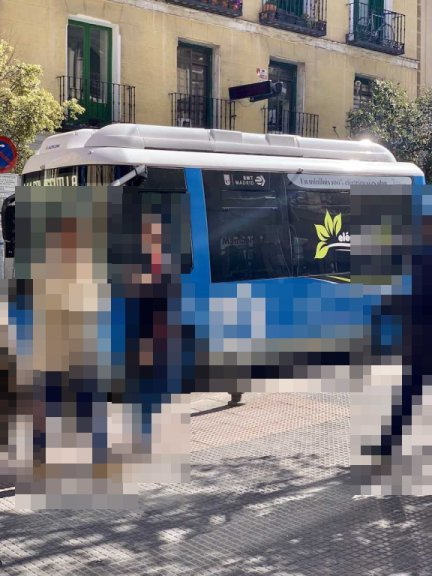

# VLM opcional: "Descrever cena"

O FluxoVC tem um botão **"Descrever cena"** que envia o frame atual a um modelo de visão e
linguagem (VLM). O VLM devolve uma descrição em texto ou responde a uma pergunta livre.

> **O VLM complementa, nunca substitui a pipeline.** Contagens, sentidos e velocidades vêm sempre
> do YOLO + ByteTrack + homografia. A resposta do VLM aparece ao lado da contagem da pipeline
> **naquele frame**, com o aviso *"Resposta gerada por IA, pode conter erros"*.

## 1. Como funciona

| Onde | O quê |
|---|---|
| `src/vlm/anonimizacao.py` | redução da resolução e pixelização de pessoas e placas |
| `src/vlm/backends.py` | `VLMLocal` (Hugging Face), `VLMClaude` (API), configuração pelo `.env` |
| `src/vlm/servico.py` | monta o frame anonimizado e escolhe a pergunta padrão |
| `src/vlm/casos.py` | os 10 casos de teste e a classificação automática das respostas |
| `scripts/avaliar_vlm.py` | roda os casos e gera [`vlm_resultados.md`](vlm_resultados.md) |
| `app.py` → `painel_vlm` | painel "🤖 Descrever cena com IA", após a análise de vídeo ou de imagem |

## 2. Configuração (`.env`)

Copie [`.env.example`](../.env.example) para `.env`. O `.env` está no `.gitignore` e **nunca** vai
para o repositório. Sem `.env`, o padrão é o backend local.

| Variável | Padrão | Uso |
|---|---|---|
| `FLUXOVC_VLM_BACKEND` | `local` | `local` ou `claude` |
| `FLUXOVC_VLM_MODELO_LOCAL` | `HuggingFaceTB/SmolVLM-256M-Instruct` | qualquer SmolVLM; o `-500M-Instruct` é mais preciso e cerca de 2× mais lento |
| `FLUXOVC_VLM_MODELO_CLAUDE` | `claude-opus-5-5` | modelo da API |
| `ANTHROPIC_API_KEY` | — | chave da API, **só** no `.env`; nenhuma chave fica no código |

**Backend local:** o modelo é baixado na primeira vez (cerca de 500 MB, para `pesos/hf/`, fora do
git) e roda em CPU. **O frame não sai do computador.** A imagem não é dividida em blocos
(`do_image_splitting=False`), o que reduziu o tempo de cerca de 37 s para 3–4 s por resposta nesta
CPU, com pouca perda para frames de trânsito.

**Backend `claude`:** envia o frame **já anonimizado** à API da Anthropic. Usa raciocínio baixo
(`effort: "low"`), porque a tarefa é simples e a resposta fica mais rápida e barata. Também usa o
*fallback* do servidor (`fallbacks: "default"`): se o modelo recusar uma imagem, a API tenta outro
modelo automaticamente. A interface avisa que o frame será enviado para fora.

## 3. Anonimização

Antes de qualquer envio, sempre:

1. **Reduz a resolução** para o lado maior ter no máximo 768 px: placas e rostos distantes deixam
   de ser legíveis.
2. **Pixeliza as pessoas** detectadas pelo YOLO (classe "pessoa" do COCO), com 10 % de margem. A
   contagem da pipeline continua ignorando pessoas: essa detecção existe **só** para anonimizar.
3. **Pixeliza a região da placa** de cada veículo: os 40 % de baixo da caixa, na faixa central de
   70 % da largura.

Os blocos têm no mínimo 10 px e são maiores em caixas grandes (no máximo cerca de 8 blocos no lado
menor), para que um rosto perto da câmera também fique ilegível.

*Foto de exemplo do Ultralytics (`bus.jpg`, AGPL-3.0) depois da anonimização: 4 pessoas e a
região da placa do ônibus pixelizadas. A original não foi incluída no repositório.*

**Limitação:** não há um detector de placas. A região é estimada pela geometria da caixa, o que
cobre as placas dianteira e traseira na maioria das vistas, mas não em todas (veículo de lado, por
exemplo). Por isso a resolução também é reduzida. Motoristas visíveis pelo para-brisa não são
detectados como pessoas, a não ser que o YOLO os encontre.

## 4. Prompts

**Descrição da cena (botão sem pergunta):**

| Backend | Prompt |
|---|---|
| `claude` | "Descreva esta cena de trânsito em até 3 frases: tipo de via, quantidade aproximada e tipos de veículos, e se o trânsito parece livre ou congestionado." |
| `local` | "Describe this traffic scene in up to 3 sentences: the type of road, the approximate number and types of vehicles, and whether traffic looks free-flowing or congested." |

O SmolVLM foi treinado quase só em inglês, por isso recebe as perguntas em inglês. A interface
avisa disso no campo de pergunta.

**Prompt de sistema (só `claude`):**

> Você analisa frames de câmeras de trânsito para um sistema de contagem de veículos. Responda em
> português do Brasil, de forma curta e objetiva, apenas com o que é visível na imagem. Se não for
> possível responder com segurança, diga isso. Regiões pixelizadas foram anonimizadas de propósito
> (pessoas e placas): não tente descrevê-las.

## 5. Casos de teste

São **10 perguntas cuja resposta a própria pipeline sabe**. A "verdade" de cada frame vem das
detecções do YOLO no frame inteiro: quantos veículos de cada classe e de que lado da imagem.

| Caso | Pergunta (português, para o `claude`) | Inglês (para o `local`) | Verdade da pipeline |
|---|---|---|---|
| C01 | Quantos veículos há na imagem? Responda só com um número. | How many vehicles are in the image? … | total |
| C02 | Quantos carros há na imagem? … | How many cars …? | nº de carros |
| C03 | Quantos ônibus há na imagem? … | How many buses …? | nº de ônibus |
| C04 | Quantas motos há na imagem? … | How many motorcycles …? | nº de motos |
| C05 | Há algum caminhão na imagem? Responda sim ou não. | Is there a truck …? | caminhões > 0 |
| C06 | Há algum ônibus na imagem? … | Is there a bus …? | ônibus > 0 |
| C07 | Há algum veículo na via? … | Is there any vehicle on the road? … | total > 0 |
| C08 | Há mais veículos na metade esquerda ou na direita? | … left half or right half …? | centros das caixas |
| C09 | Quais tipos de veículo aparecem? | Which types of vehicle appear …? | classes presentes |
| C10 | Qual é o tipo de veículo mais comum? | What is the most common type …? | classe mais frequente |

**Classificação automática** (`src/vlm/casos.py`, com testes em `tests/test_vlm.py`):

| Categoria | Regra |
|---|---|
| **correta** | igual à verdade; numa cena sem veículos, também vale "não há veículos" |
| **incompleta** | parcialmente certa (citou só alguns tipos) ou sem resposta clara (nenhum número, nenhum sim/não, nenhum lado) |
| **incorreta** | resposta clara e errada sobre algo que existe na cena |
| **alucinada** | afirma algo que **não está** na cena: conta veículos de um tipo ausente, diz "sim" para um tipo ausente, cita um tipo ausente, ou aponta um lado numa cena sem veículos |

No caso C08, vale o lado citado **primeiro** ("a esquerda tem mais que a direita" significa
esquerda). A classificação é uma primeira passada. O relatório tem a coluna **revisão** para a
equipe confirmar ou corrigir cada linha.

## 6. Resultados

Os resultados completos estão em [`vlm_resultados.md`](vlm_resultados.md), gerado com
`python scripts/avaliar_vlm.py`. A primeira rodada usou o **SmolVLM-256M (local, CPU)** em 2 fotos
reais de exemplo do Ultralytics, que não estão no repositório:
- `bus.jpg`: um ônibus e pedestres;
- `zidane.jpg`: duas pessoas e nenhum veículo, um bom teste de alucinação.

| Categoria | Respostas |
|---|---|
| correta | 15 de 20 (75 %) |
| incorreta | 1 (5 %) |
| alucinada | 4 (20 %) |
| **Latência média** | **3,4 s** por resposta (até 18 s em respostas longas) |

**O que os erros mostram:**
- **Alucinação de contagem:** numa foto sem nenhum veículo, o modelo respondeu "10" para
  "quantos veículos?", e "Motorcycle" para "quais tipos aparecem?".
- **Noção espacial fraca:** errou as duas perguntas de esquerda × direita.
- **Acertos:** as perguntas de sim/não foram as mais confiáveis (6 de 6).

Isso confirma a escolha de arquitetura: o VLM serve para **descrever** a cena em linguagem
natural, por exemplo "via urbana com um ônibus azul parado e pedestres na calçada". Os números
continuam vindo da pipeline, que é o que vale para a contagem.

`<Equipe: rodar de novo com 3–5 frames do vídeo real
(python scripts/avaliar_vlm.py --video data_samples/<vídeo>.mp4 --frames 3), revisar a coluna
"revisão" e atualizar esta seção.>`

O backend `claude` foi testado com um cliente falso (formato da requisição, imagem em PNG base64,
recusa e erros), mas **não com chamadas reais**, para não gastar créditos sem a decisão da equipe.
Para comparar os dois backends: `python scripts/avaliar_vlm.py --imagens <pasta> --backend claude --saida docs/vlm_resultados_claude.md`.

## 7. Limitações e cuidados

- Respostas de VLM **podem estar erradas ou ser inventadas**: o aviso aparece sempre junto da
  resposta.
- O SmolVLM-256M é pequeno: bom para descrições curtas, fraco para contagem e posição.
- A anonimização reduz o risco, mas não é perfeita (ver seção 3).
- Com o backend `claude`, a imagem anonimizada sai do computador. Use só com vídeos que a equipe
  pode compartilhar.
- Em CPU, a primeira consulta inclui o tempo de carregar o modelo (cerca de 2 s depois do
  download).
